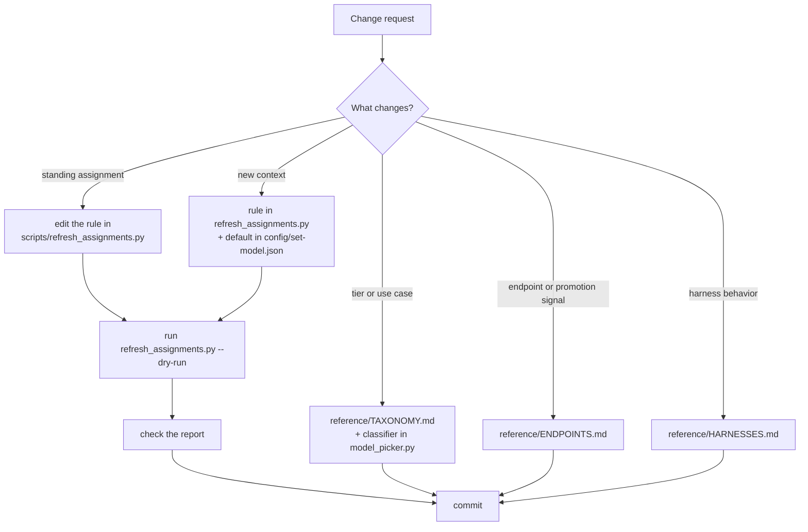

# AGENTS.md

Instructions for agents that work in this repository.

## What this repository is

This repository is the source of truth for the model-picker skill. The
installer symlinks this repository to `~/.agents/skills/model-picker`. The
skill fetches the Nous Portal and OpenRouter catalogs, classifies each
model, and picks a model per work context. A systemd timer refreshes the
catalog and the context assignments once a day.

## Routing for agents

This table routes each decision to the file that governs it. Read only the
file that the decision needs.

| Decision or task | Governed by |
|---|---|
| Which model a context uses | `config/set-model.json` (data, live copy at `~/.pi/agent/set-model.json`) |
| Why a context uses that model | `scripts/refresh_assignments.py` (the policy rules) |
| What tiers and use cases mean | `reference/TAXONOMY.md` |
| Which endpoints exist, promotion signals, schema | `reference/ENDPOINTS.md` |
| How to set a model in a harness (pi, hermes, opencode) | `reference/HARNESSES.md` |
| The workflow when a user asks for a model | `SKILL.md` |
| How the daily refresh runs | `systemd/model-picker-refresh.timer`, `systemd/model-picker-refresh.service` |
| The pi `/set-model` command | `extensions/set-model.ts` |
| How to install on a new machine | `install.sh` |

## Standing context map

`config/set-model.json` holds the standing map. The daily refresh writes
this map through these rules.

| Context | Rule |
|---|---|
| deep-research | Newest Kimi (moonshotai) flagship — long-context lineage |
| coding | Top non-preview flagship in the OpenRouter `programming` ranking that the Nous Portal serves |
| reasoning | Newest DeepSeek non-flash reasoning flagship |
| image-generation | Newest Qwen max with vision input |
| routing | Newest MiniMax flash — cheap agentic dispatch |
| fast | Cheapest value tier with long-context and agentic support on the Nous Portal |
| general | Newest Z.ai GLM flagship (non-flash) |

## Change routing

## Change rules

- To change a standing assignment, change the rule in
  `scripts/refresh_assignments.py`. Then run the script once. Do not
  hand-edit `config/set-model.json`: the next daily run overwrites a
  hand edit.
- To freeze one context, set `"lock": true` on its entry in
  `~/.pi/agent/set-model.json`. The daily refresh then leaves the context
  alone. A locked context keeps its model until a person removes the lock.
- To change tier or use-case definitions, change
  `reference/TAXONOMY.md`. Then align the classifier in
  `scripts/model_picker.py` with the new definitions.
- To add a context, add a rule in `scripts/refresh_assignments.py`. Also
  add a default entry in `config/set-model.json`. The pi extension lists
  contexts from the live map. No extension change is needed.
- After any change to scripts, run `python3 scripts/refresh_assignments.py
  --dry-run` and check the report before you commit.

## Documentation convention

This repository splits its docs by audience.

- Machine-facing docs — this file, `SKILL.md`, and `reference/`. Write
  these in Simplified Technical English. Keep procedural sentences under
  20 words. Keep descriptive sentences under 25 words. Use one word for
  one meaning. Use the imperative. Put a condition before its action.
- `README.md` is human-facing. It uses plain language. Keep the reader's
  task first. Address the reader as "you".
- Do not merge the two audiences into one file.
- Use mermaid diagrams for flows and hierarchies. Keep tables for data
  rows. GitHub renders mermaid for humans. Agents read the diagram source
  as text. Validate a changed diagram with `mmdc` before you commit.

## Verified facts

A person verified every endpoint and signal in `reference/ENDPOINTS.md`
against the live services. Do not check these facts again during normal
work. If an endpoint stops working, update `reference/ENDPOINTS.md` and
say in the commit what changed.
