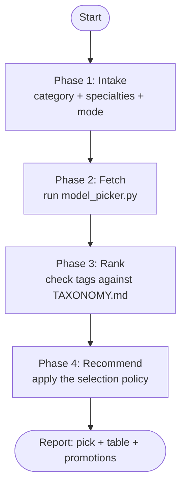

# Model Picker

Pick the best LLM for a task. Fetch the live Nous Portal and OpenRouter catalogs. Classify each model on three axes: capability tier, deployment size, primary use case. Apply the selection policy. A promotion or a free tier can displace a default model.

## Workflow



## Phase 1: Intake

Classify the request.

- **Task category** — one OpenRouter category: `programming`, `roleplay`,
  `marketing`, `marketing/seo`, `technology`, `science`, `translation`,
  `legal`, `finance`, `health`, `trivia`, `academia`. Map a free-text task to
  the closest category. A generic request has no category.
- **Specialty needs** — one or more of: long context, hard reasoning,
  agentic work, vision, self-hosting. See
  [TAXONOMY.md](reference/TAXONOMY.md) for the definitions.
- **Catalog review** — if the user asks what is new or on promotion, use
  `--promos` or `--all` instead of `--task`.

Completion criterion: one category (or none), a specialty list, and one mode
chosen: `--task`, `--promos`, or `--all`.

## Phase 2: Fetch

Run the picker script. Do not call the APIs by hand.

```bash
# Top models for a task, merged from both catalogs:
python3 ~/.agents/skills/model-picker/scripts/model_picker.py --task programming

# Current promotions and free tiers across both catalogs:
python3 ~/.agents/skills/model-picker/scripts/model_picker.py --promos

# Full classified catalog (large):
python3 ~/.agents/skills/model-picker/scripts/model_picker.py --all [--json]
```

The script fetches `https://inference-api.nousresearch.com/v1/models` (Nous
Portal) and `https://openrouter.ai/api/v1/models` (OpenRouter). The script
merges duplicate models, detects promotions, and prints a markdown table.
The script caches responses for 24 h in `~/.cache/model-picker/`. The systemd timer
`model-picker-refresh.timer` warms the cache once a day at 06:30. The same
timer run refreshes the context assignments in
`~/.pi/agent/set-model.json` and writes
`~/.cache/model-picker/assignments-report.md`. Pass `--fresh` to bypass the
cache. See [ENDPOINTS.md](reference/ENDPOINTS.md) for endpoints, promotion
signals, response schema, and ingestion cadence.

Completion criterion: the script ran without error and its table is in
context. If the network fails, run the script once more with `--fresh`. If
the second run fails, use the raw curl commands in
[ENDPOINTS.md](reference/ENDPOINTS.md).

## Phase 3: Rank

The tier and specialty tags are heuristics. Check each candidate against
[TAXONOMY.md](reference/TAXONOMY.md) before you recommend it.

- **Capability tier** — frontier, flagship, value, small. Frontier:
  Anthropic, OpenAI, X.ai, Google flagships. Flagship: the top tier of
  non-frontier labs (Kimi, DeepSeek, MiniMax, Qwen). Value: the flash,
  mini, lite class. Small: open models up to 32B.
- **Deployment size** — API-only or open weights. `hugging_face_id`
  present means the model is downloadable and self-hostable. Also record
  the parameter count and the context window.
- **Primary use case** — long-context specialist, reasoning specialist,
  agentic (tool calling), vision, general.

Sort the candidates by capability tier first. Sort by task rank second. The
script orders the task list by OpenRouter category usage. Sort by price
third.

Completion criterion: every candidate row is checked against all three axes.
Every mis-tagged row is corrected in the report.

## Phase 4: Recommend

Apply the selection policy in this order:

1. **Capability** — use the highest tier that satisfies the task difficulty.
2. **Task fit** — the model must serve the category and the specialty. Deep
   research needs long context. Agentic routing needs tool calling.
3. **Value** — price per M tokens and active promotions break ties. A
   promoted flagship can beat an unpromoted flagship at equal fit.
4. **Openness** — prefer open weights at equal capability, value, and fit.
   If the user needs local deployment, open weights are mandatory.

Routing defaults — override a default only with a stated reason:

- Deep research and very long documents → Kimi (Moonshot).
- Cheap agent routing and dispatch → MiniMax flash class.
- Hard reasoning → DeepSeek reasoning or a frontier reasoning model.
- Coding → top of the OpenRouter `programming` list. Use the frontier tier
  when quality matters.
- Bulk cheap work → value tier. Use `:free` variants for zero-cost
  experiments.

Completion criterion: one primary pick and one cheaper alternate. Each pick
states tier, deployment, use case, price, and promotion status.

## Setting the model in a harness

If the user asks to set the model for the conversation, first classify the
conversation into one context type. The types: `deep-research`, `coding`,
`reasoning`, `image-generation`, `routing`, `fast`, `general`. Then pick
per Phase 4. Apply the pick in the harness as
[HARNESSES.md](reference/HARNESSES.md) describes.
In pi, `/set-model <context>` sets the model and the thinking level from
`~/.pi/agent/set-model.json`. If the pick differs from that file, say so.
The file is the standing map that this skill maintains after catalog
reviews.

Completion criterion: the model is set, or the exact command is given. The
standing map is updated if the live pick differs.

## Report format

1. **Pick** — the primary model with one or two sentences of justification.
   Name the tier and the use case.
2. **Table** — top candidates: model, source (nous, openrouter, or both),
   tier, use case, openness, context, $/M in and out, promotion.
3. **Promotions** — every discount, schedule, or free tier that changes the
   answer. State the discount size.

## Common pitfalls

| Issue | How to handle |
|------|---------------|
| Portal web UI (portal.nousresearch.com) is bot-blocked (Vercel checkpoint) | Do not scrape the HTML page. Use the inference API. |
| User wants the model actually set, not only recommended | Apply per HARNESSES.md. pi has `/set-model`, hermes has `/model`, opencode has `/models`. |
| Image-generation context | Set a vision flagship for the conversation. Image generation runs through codemode image models. See HARNESSES.md. |
| `:free`, `:batch`, `:US` variants | The script hides batch and extended variants. `:free` rows are real picks with rate limits. |
| Stale prices after a promotion ends | Run the script with `--fresh`. |
| Embedding models in the catalog | The script tags them `embed`. Do not recommend them for generation tasks. |
| Category does not exist (e.g. `math`) | The API accepts only the 12 listed categories. Map to the closest category, or use `--all`. |
| A model appears in one fetch and is gone in the next | The Nous catalog flaps between requests. Treat a single fetch as advisory. See ENDPOINTS.md. |
