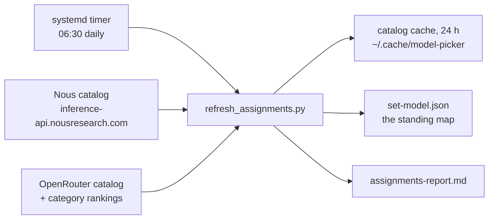

# Verified endpoints

Everything the picker script (and a fallback manual run) needs. All verified
live against the real services. Both APIs share the same response schema
(OpenRouter-compatible), so one parser handles both.

## Catalogs

| Source | URL | Notes |
|---|---|---|
| Nous Portal (inference API) | `https://inference-api.nousresearch.com/v1/models` | The machine-readable catalog behind portal.nousresearch.com. ~385 models. OpenAI-compatible endpoints (`/v1/chat/completions`) with Nous API keys. |
| OpenRouter | `https://openrouter.ai/api/v1/models` | ~450 models, same schema. |

The portal web UI (`https://portal.nousresearch.com/models`) is behind a
Vercel security checkpoint (bot detection → 429). Do not scrape it; the
inference API is the catalog.

## Top models by task

Only OpenRouter's category list is a real task ranking. The list holds
the top ~20 models by usage.

```
GET https://openrouter.ai/api/v1/models?category=programming
```

The API accepts only these categories.

`programming`, `roleplay`, `marketing`, `marketing/seo`, `technology`,
`science`, `translation`, `legal`, `finance`, `health`, `trivia`, `academia`.

**Never use the Nous category endpoint for ranking.** The Nous category endpoint returns the whole catalog in an arbitrary order. The list includes embedding models. The Nous catalog also flaps between requests: a model appears in one fetch and disappears in the next. Treat a single fetch as advisory. Do not trust a pick that only one request showed.

## Ingestion cadence



The picker script fetches catalog data once a day and caches responses
for 24 h in `~/.cache/model-picker/`. The systemd user timer
`model-picker-refresh.timer` warms the cache daily at 06:30
(`Persistent=true`). The same timer run refreshes the context assignments
in `~/.pi/agent/set-model.json` through `scripts/refresh_assignments.py`.
The refresh rules are deterministic. No LLM runs in the timer. The run
writes a report to `~/.cache/model-picker/assignments-report.md`. Pass
`--fresh` to bypass the cache on demand. `/set-model update` in pi starts
a full refresh from the session. Lock a context by setting
`"lock": true` on its entry in `set-model.json`.

## Model record schema (fields the picker uses)

```jsonc
{
  "id": "moonshotai/kimi-k3",            // canonical id; ~-prefixed ids are aliases
  "hugging_face_id": "moonshotai/Kimi-K3", // present = open weights
  "context_length": 1048576,
  "architecture": {
    "input_modalities": ["text", "image"], // image = vision capable
  },
  "pricing": {
    "prompt": "0.0000012",               // USD per token (multiply by 1e6 for $/M)
    "completion": "0.000006",
    "original": { "prompt": "0.000006" }, // PRESENT = active % off promo
    "overrides": [                        // PRESENT = scheduled promo
      { "utc_days": ["saturday", "sunday"], "prompt": "0.0000005" }
    ]
  },
  "supported_parameters": ["tools", "reasoning", ...], // tools = agentic
  "reasoning": { "default_enabled": true }            // reasoning specialist
}
```

## Promotion signals

Three signals, listed by value.

| Signal | Meaning | Example |
|---|---|---|
| `pricing.original` present | Standing percent-off promo; current `pricing.*` is the discounted price | tencent/hy4 at 20% of original = 80% off |
| `pricing.overrides` present | Time-boxed promo: `utc_days` restricts to weekdays/weekends | "weekend 50% off" |
| `:free` id suffix | Free tier variant, rate-limited (e.g. 20 req/min); prompts cost 0 | `deepseek/deepseek-v4.1-flash:free` |

Other variant suffixes: `:batch` (batch pricing, 50% off, async),
`:US`/`:EU` (region routing), `:extended` (higher rate limits). The picker
script hides batch/extended/US rows and keeps `:free` ones.

## Raw curl fallbacks

If the script fails, run these and read the JSON directly:

```bash
curl -s https://inference-api.nousresearch.com/v1/models > /tmp/nous.json
curl -s https://openrouter.ai/api/v1/models > /tmp/or.json
curl -s "https://openrouter.ai/api/v1/models?category=programming" > /tmp/or_cat.json
```