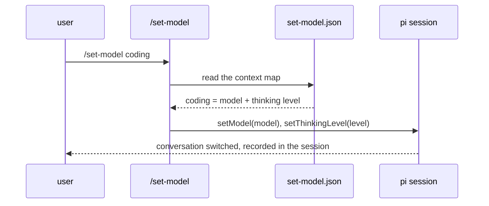

# Setting the model per harness

How each surface sets the conversation model. The context types:
deep-research, coding, reasoning, image-generation, routing, fast,
general. The compliance matrix at the end lists every primary surface.

## pi (this harness)

**`/set-model <context>`** — registered by `~/.pi/agent/extensions/set-model.ts`.
Switches the conversation model and thinking level in one step, recorded in
the session (restored on resume). Reads the context map from
`~/.pi/agent/set-model.json` — data, not code. With no argument it opens a
context picker. Aliases: research, code, thinking, image, route, quick.

**`/set-model update`** — runs the assignment refresh now (same job as the
daily timer) and reports the diff. The timer:
`systemctl --user list-timers model-picker-refresh.timer` — daily 06:30,
`Persistent=true`, unit files in `~/.config/systemd/user/`.

Other paths:

- `/model` — interactive model picker; `Ctrl+S` on a model saves it as the
  default for new sessions. Models come from the `nous-portal` extension
  (full Nous catalog, OpenRouter-style ids under provider `nous-portal`).
- `Ctrl+P` cycles scoped models; `/scoped-models` and settings
  `enabledModels` + `modelThinkingLevels` control the cycle and startup
  levels. Current scoped set lives in `~/.pi/agent/settings.json`.
- Startup: `--provider nous-portal --model z-ai/glm-5.3` or settings
  `defaultProvider`/`defaultModel`.
- Per-request routing without switching: virtual models
  (`pi.registerVirtualModel` in an extension) pick a physical model per
  request. Use a virtual model if a context must route every turn
  automatically, with no command.

**Image generation is not a conversation model.** pi generates images
through codemode: `models.generateImages()` with image-type models (e.g.
`openrouter/google/gemini-2.5-flash-image`), which never appear in `/model`.
`/set-model image-generation` sets a vision flagship (e.g.
`qwen3.8-max-0902`) so the conversation can read images. The codemode image
model creates images.

## hermes (`~/.hermes`)

- `/model <model>` — gateway slash command; sets a per-session model
  override (`gateway/slash_commands_model.py` → `set_model_override`).
  Model ids are OpenRouter-style: `z-ai/glm-5.3`, `moonshotai/kimi-k3`.
- `/fast`, `/reasoning` — service tier and reasoning display toggles.
- Standing config in `~/.hermes/config.yaml`: `model.default`
  (`google/gemini-3.8-flash` via provider `nous`). The file also holds
  per-role `reference_models` with `reasoning_effort`. That file is the
  hermes equivalent of the context map.
- Hermes plugins live in `~/.hermes/plugins/` (`plugin.yaml` +
  `__init__.py`). The manifest key is `provides_hooks`. Enable a plugin
  through `plugins.enabled` in config.yaml. A hermes-side `/set-model`
  plugin is a possible follow-up. No such plugin is installed yet.

## opencode (`~/.config/opencode`)

- `/models` — built-in model picker for the session.
- `opencode.json` — per-agent models and custom providers. The file is
  empty on this machine. An agent entry like `{ "model": ... }` pins a
  model per agent type. That entry is the opencode analogue of the context
  map.

## Compliance across the primary surfaces

| Surface | Kind | Skill loads from | Model setting | Standing map applies |
|---|---|---|---|---|
| pi | agent harness | `~/.agents/skills/model-picker` | `/set-model <context>` | yes |
| hermes | agent gateway | `~/.hermes/skills/model-picker` | `/model <model>` | yes |
| grok | agent CLI | `~/.grok/skills/model-picker` | `~/.grok/config.toml` `[models]` | no (xAI models only) |
| herdr | multiplexer | inherited from the agent in the pane | none of its own | via the agent |
| tuios | multiplexer | inherited from the agent in the pane | none of its own | via the agent |
| buzz.xyz | hosted web app | not loadable | in-app only | no |

## grok (`~/.grok`)

- Skills: grok reads `~/.grok/skills`. `install.sh` links model-picker
  there.
- Models: grok runs xAI models through its own proxy
  (`cli-chat-proxy.grok.com`). Set the default model in
  `~/.grok/config.toml` under `[models]` (`default`,
  `default_reasoning_effort`). The standing map does not apply: grok
  serves only grok models. Use the skill to rank `x-ai` models from the
  catalog, then write the winner into `[models] default`.
- `fork_secondary_model` in `[ui]` names the model for forked turns
  (e.g. `grok-build` for coding forks).

## herdr and tuios (multiplexers)

- Both surfaces host terminals, not models. An agent in a pane loads
  skills from its own skill path. Compliance is inherited from that
  agent.
- Herdr starts agents in panes. To apply the standing map at launch,
  start pi with the context model:
  `pi --provider nous-portal --model <id>`.
- TUIOS is a terminal window manager that recognizes agents in panes.
  The site is tuios.dev. The binary is `/usr/bin/tuios`. The config is in
  `~/.config/tuios`. TUIOS has no model or skill settings of its own.
  Compliance is inherited, same as herdr.

## buzz.xyz (web — the caveat)

- A hosted web app. It cannot read local skills or local config. Model
  selection happens inside the app. This repo cannot reach it. Treat any
  model choice there as manual.

## Superseded skill: portal-model-assign

- `portal-model-assign` is the predecessor of this skill. It assigns
  non-frontier Nous Portal models per task with promotion priority
  (`scripts/assign.py`). This skill supersedes it: same goal, live
  catalogs, daily refresh, and harness integration.
- The old skill still lives in `~/.grok/skills/portal-model-assign` and
  links into `~/.hermes/skills`. Remove it after you confirm nothing
  still calls it.
